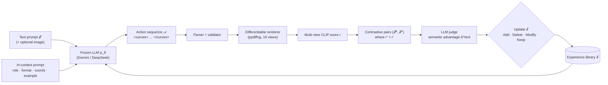
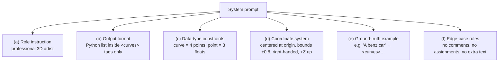
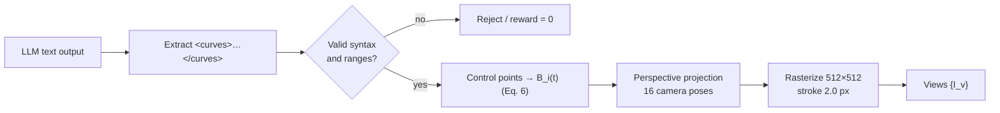
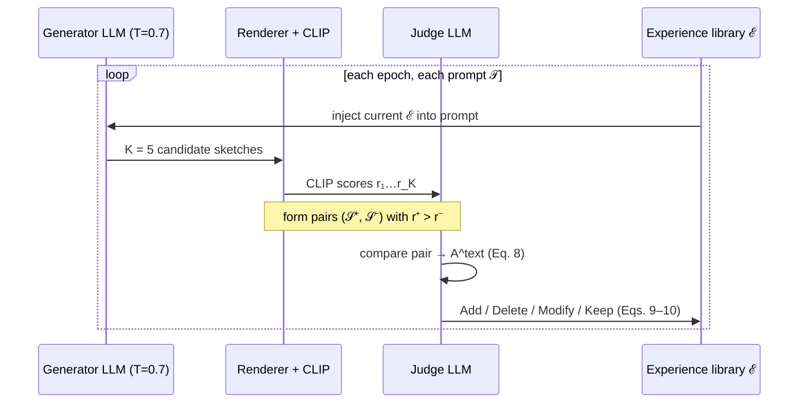
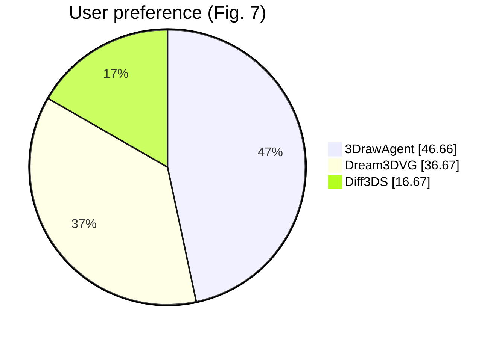
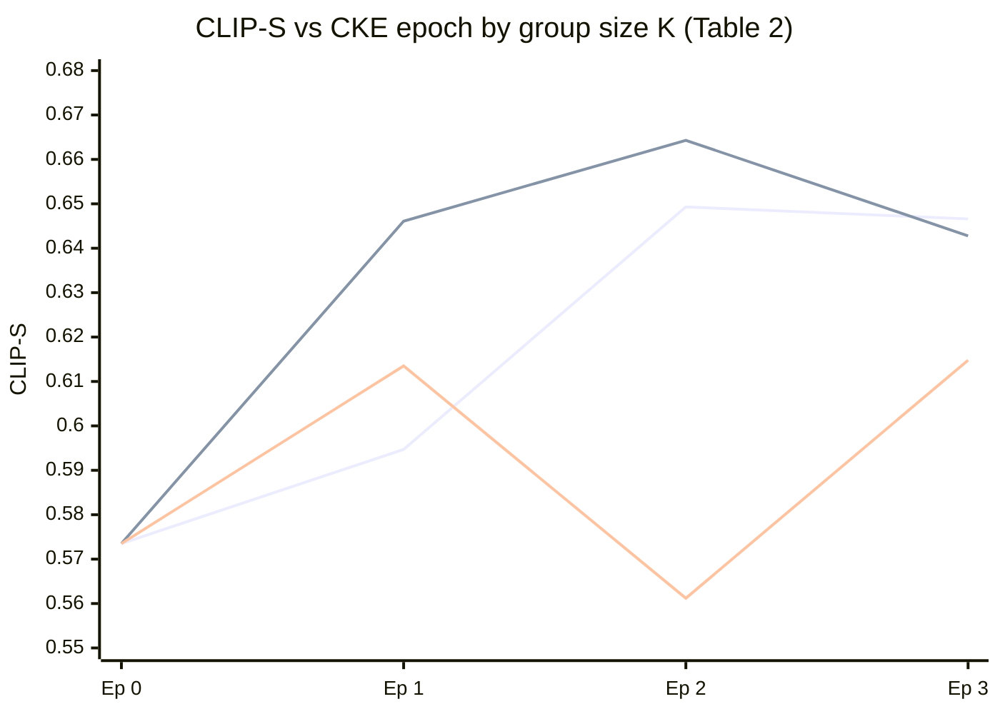
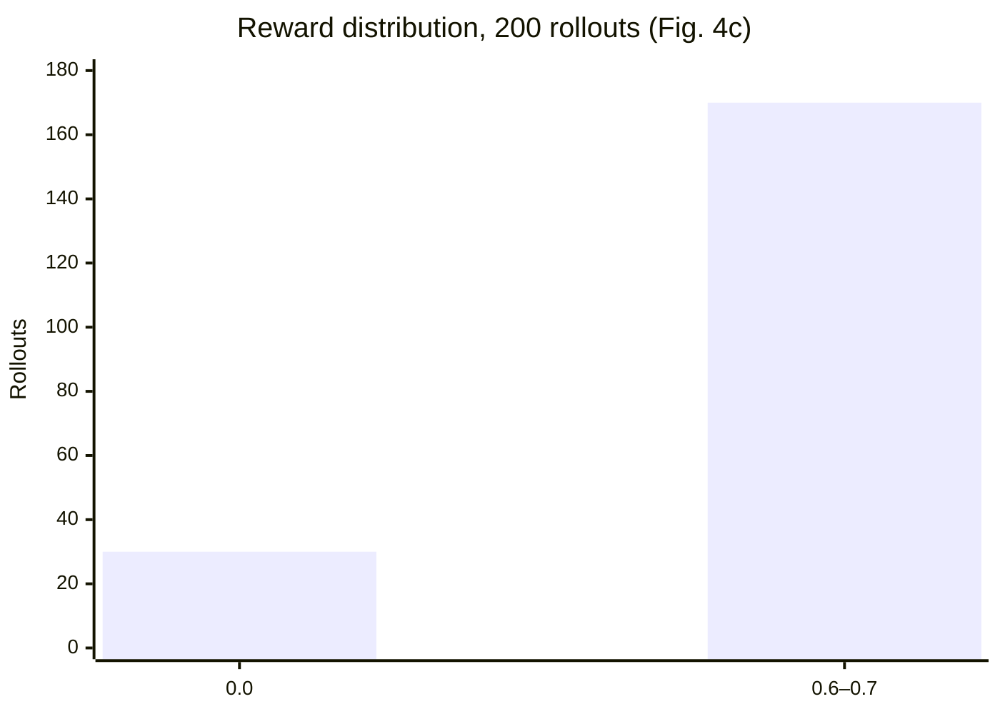
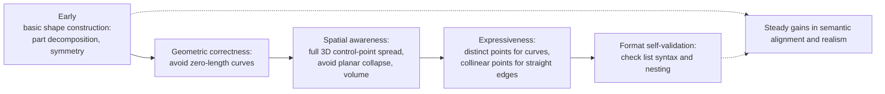
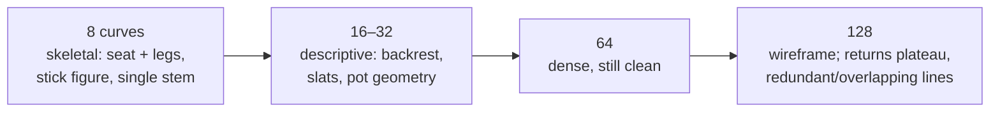
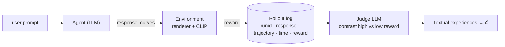

# 3DrawAgent: Teaching LLM to Draw in 3D with Early Contrastive Experience

**Authors:** Hongcan Xiao¹, Xinyue Xiao¹ ², Yilin Wang¹, Yue Zhang³, Yonggang Qi¹ (corresponding)
¹ Beijing University of Posts and Telecommunications · ² Jiangnan University · ³ HaoHan Data
**Source:** [arXiv:2604.08042](https://arxiv.org/abs/2604.08042)

> **About this file.** This is a structured markdown digest, not a verbatim transcription. The prose is condensed and paraphrased. Equations, numeric tables, and prompt/log formats are kept faithfully. Figures that are rendered sketches are noted in brackets; figures that show structure or data are redrawn in Mermaid. For the exact wording, see the original PDF.

---

## Abstract (summary)

3DrawAgent is a **training-free**, language-driven system that has an LLM draw a 3D sketch as a sequence of cubic Bézier curves. It does not fine-tune the model. Instead, it adapts **training-free GRPO** into a *pairwise* scheme:

1. Generated sketches are ranked against each other using multi-view CLIP scores.
2. An LLM judge explains why the better sketch beats the worse one.
3. Those explanations are distilled into a textual **experience library** that is fed back into the prompt.

The authors report competitive CLIP and aesthetic scores against optimization-based 3D sketch methods, at a fraction of the compute cost.

---

## 1. Motivation & Contributions

- Earlier language-driven sketch agents, such as SketchAgent, work only on a 2D canvas. They have no notion of depth, projection, or cross-view consistency.
- Diffusion/SDS and implicit-field 3D methods need geometric supervision or long per-instance optimization, so they are slow and non-interactive.
- Training-free GRPO normally needs scalar rewards or ground-truth references. Neither fits open-ended creative tasks well.

**Contributions**
1. A Bézier-based 3D sketch "language" that LLMs can emit step by step.
2. *Relative experience optimization*: pairwise, self-supervised prompt reinforcement that needs no ground truth.
3. A hybrid reward that combines CLIP perceptual scores with qualitative critique from an LLM judge.

[Figure 1: Top — prior methods rely on pretrained diffusion priors. Bottom — 3DrawAgent refines an LLM's spatial reasoning without training.]

---

## 2. Related Work (condensed)

| Area | Representative work | Gap the paper targets |
|---|---|---|
| Language-driven drawing agents | SketchRNN, CLIPDraw, SketchAgent, DeepSVG | Limited to 2D |
| Training-free adaptation | Self-Refine, Reflexion, Training-free GRPO | Relies on scalar or ground-truth rewards |
| 3D sketch / curve modeling | DeepCAD, SketchGraphs, Sketch2CAD, Text2CAD, SketchSplat, EdgeGaussians, CurveGaussian, 3Doodle, Diff3DS, ViewCraft3D, Dream3DVG | Heavy per-instance optimization (e.g., SDS); no sequential planning |

---

## 3. Method

### 3.1 Problem setup

Given a text prompt $\mathcal{T}$ (and optionally a reference image), the system outputs a sketch $\mathcal{S}$ made of $N$ cubic Bézier curves:

$$
\mathcal{S} = \{\mathbf{C}_1, \mathbf{C}_2, \dots, \mathbf{C}_N\} \tag{1}
$$

$$
\mathbf{C}_i = \operatorname{Bezier}\!\left(\mathbf{P}_i^{(0)}, \mathbf{P}_i^{(1)}, \mathbf{P}_i^{(2)}, \mathbf{P}_i^{(3)}\right), \qquad \mathbf{P}_i^{(k)} \in \mathbb{R}^3 \tag{2}
$$

The method has three stages:
1. LLM in-context generation of 3D curves.
2. Contrastive experience learning, using an accumulation loop inspired by training-free GRPO.
3. Final generation conditioned on the learned experience.


*Mermaid rendering of Figure 2 (framework overview).*

### 3.2 Language-driven 3D sketch planning

**Action language.** Each drawing action is one curve:

$$
a_t = \texttt{draw\_bezier}\!\left[\left(\mathbf{P}^{(0)}, \mathbf{P}^{(1)}, \mathbf{P}^{(2)}, \mathbf{P}^{(3)}\right)\right] \tag{3}
$$

A full sketch is $\mathcal{A} = \{a_1, \dots, a_N\}$. Given in-context examples $c = (\mathcal{T}_i, \mathcal{A}_i)$, the frozen model ($\theta$) defines

$$
p_\theta(\mathcal{A} \mid \mathcal{T}, c) \tag{4}
$$

**Prompt design.** The prompt has six parts:



**LLM as spatial planner.** For a new prompt, the model produces the most likely action sequence in a single pass:

$$
\hat{\mathcal{A}} = \arg\max_{\mathcal{A}} \; p_\theta(\mathcal{A} \mid \mathcal{T}, c) \tag{5}
$$

**Parsing and rendering.** The parser does three things:
- extracts the contents of the `<curves>` block
- checks the syntax and the numeric ranges
- evaluates each curve $C_i = \{P_0, P_1, P_2, P_3\}$, $P_j \in \mathbb{R}^3$, in Bernstein form

$$
B_i(t) = \sum_{j=0}^{3} \binom{3}{j} (1-t)^{3-j}\, t^{j}\, P_j, \qquad t \in [0,1] \tag{6}
$$

The curves are then rasterized with depth awareness by a differentiable renderer that supports orthographic or perspective projection. This produces consistent 2D views for scoring.



### 3.3 Contrastive knowledge extraction (CKE)

**Difference from training-free GRPO.** Training-free GRPO compares a whole *group* of rollouts: it picks a winner and computes relative advantages against the rest. 3DrawAgent relaxes this to **pairs**. It assumes a useful preference signal exists between any two outputs whose quality differs noticeably. The method needs no numeric group advantage, no ground truth, and no gradients, which makes it black-box prompt tuning.

**CLIP-based scoring.** Each sketch is rendered into $V$ views $\{I_v\}$ and scored against the prompt:

$$
r_{\text{CLIP}} = \frac{1}{V} \sum_{v=1}^{V} \cos\!\left(\mathbf{E}_I(I_v),\; \mathbf{E}_T(\mathcal{T})\right) \tag{7}
$$

where $\mathbf{E}_I$ and $\mathbf{E}_T$ are CLIP's image and text encoders.

**Contrastive pairs.** For sketches $\{\mathcal{S}_i\}$ with scores $\{r_i\}$, the method forms pairs $(\mathcal{S}_i^{+}, \mathcal{S}_j^{-})$ such that $r_i > r_j$. Each pair carries a preference, not an absolute label.

**LLM as semantic advantage judge.**

$$
A^{\text{text}} = \operatorname{LLM}\!\left(p_{\text{judge}},\; \mathcal{T},\; \mathcal{S}_i^{+},\; \mathcal{S}_j^{-},\; \mathcal{E}\right) \tag{8}
$$

Here $p_{\text{judge}}$ is a template that asks why one sketch is better than the other, in terms of structural integrity, spatial continuity, and geometric plausibility. The judge is also given the current experience library $\mathcal{E}$.

**Knowledge update.** The natural-language advantage edits the experience library through discrete operations:

$$
\mathcal{E} \leftarrow \operatorname{Update}\!\left(\mathcal{E},\, A^{\text{text}}\right) \tag{9}
$$

$$
\operatorname{Update} \in \{\text{Add},\ \text{Delete},\ \text{Modify},\ \text{Keep}\} \tag{10}
$$



### 3.4 Drawing with extracted experience

At inference, the library is added to the context as an extra prompt segment:

$$
o = p_\theta(o \mid \mathcal{T}, \mathcal{E}) \tag{11}
$$

The model then produces the full `<curves>` list in one pass, which is parsed and rendered.

---

## 4. Experiments

### 4.1 Setup

| Item | Setting |
|---|---|
| Renderer | Custom batched renderer on pydiffvg; 16 fixed views; 512×512; perspective |
| LLMs | DeepSeek-V3.2-Exp (open), Gemini-2.5 Pro (commercial) |
| CKE sampling | K = 5 candidates per query, temperature 0.7 |
| Inference | temperature 0.3, Pass@1 |
| Hardware | single RTX 3090 (the LLMs are accessed via API) |
| Prompts | Categories from ModelNet40 and QuickDraw; Diff3DS-Text (28 complex prompts); Diff3DS-Image (37 reference images) |
| Baselines | Diff3DS (SDS on rational Béziers), 3Doodle (Béziers + superquadrics from multi-view images), Dream3DVG (3DGS-guided dual-branch) |

**Metrics**
- **CLIP-S$_T$**: mean cosine similarity between the CLIP ViT-B/32 text embedding of $\mathcal{T}$ and each of the 16 rendered views.
- **CLIP-S$_I$**: mean cosine similarity between the reference-image embedding and the 16 views.
- **AES**: LAION improved aesthetic predictor (frozen CLIP ViT-L/14 → 768-d normalized embedding → MLP), averaged over the 16 views.

### 4.2 Main results

**Table 1.** Text-to-3D (category-level and fine-grained) and image-to-3D results. "–" means not reported.

| Method | Trained | Cat. CLIP-S$_T$ | Cat. AES | Fine CLIP-S$_T$ | Fine AES | Img CLIP-S$_I$ | Img AES |
|---|:---:|---:|---:|---:|---:|---:|---:|
| Diff3DS | ✓ | 0.648 | 3.791 | 0.650 | 3.770 | 0.865 | 3.828 |
| 3Doodle | ✓ | – | – | – | – | 0.869 | **4.264** |
| Dream3DVG | ✓ | **0.660** | 4.150 | **0.670** | 4.174 | – | – |
| 3DrawAgent (DeepSeek-V3.2) | ✗ | 0.643 | 4.108 | 0.664 | 4.146 | – | – |
| 3DrawAgent (Gemini-2.5 Pro) | ✗ | 0.649 | **4.161** | 0.669 | **4.175** | **0.873** | 4.255 |

[Figure 3: Qualitative comparisons — (a) category-level text-to-3D, (b) fine-grained text-to-3D (e.g., a phoenix wrapped in flames), (c) image-to-3D.]

**Qualitative takeaways**
- Diff3DS strokes tend to be fragmented or chaotic.
- Dream3DVG gets the overall volume right but the structure is imprecise.
- 3DrawAgent produces cleaner part structure and handles compositional prompts better. Its image-to-3D wireframes are sparser and cleaner.

**User study.** 30 participants, 40 prompts, rotating 360° videos, one pick per prompt.



### 4.3 Ablations

**Table 2.** CLIP-S on the ModelNet40 test set across CKE epochs. The Base model at Ep 0 has no experience.

| Setting | Variant | Ep 0 | Ep 1 | Ep 2 | Ep 3 | Ep 4 |
|---|---|---:|---:|---:|---:|---:|
| **Experience library** | Base (w/o CKE) | 0.5735 | – | – | – | – |
| | Ours (w/ CKE) | 0.5735 | 0.6461 | **0.6643** | 0.6428 | 0.6416 |
| **Group size K** | K = 2 | 0.5735 | 0.5947 | 0.6493 | 0.6466 | – |
| | K = 5 | 0.5735 | 0.6461 | **0.6643** | 0.6428 | – |
| | K = 10 | 0.5735 | 0.6135 | 0.5612 | 0.6148 | – |
| **Ground truth** | GT = False | 0.5735 | 0.6461 | 0.6643 | 0.6428 | 0.6416 |
| | GT = True | 0.5735 | **0.6648** | 0.6552 | 0.6141 | 0.6261 |



**Findings**
- CKE raises CLIP-S from 0.5735 to 0.6643 by epoch 2. The slight decline afterwards is attributed to LLM "over-reasoning."
- K = 5 is the best trade-off. K = 2 lacks diversity, and K = 10 is unstable with no gain.
- Ground truth speeds up epoch 1, but running without it reaches essentially the same peak and learns more steadily.

### 4.4 Analysis

**Rollout statistics** (200 rollouts of one task, Fig. 4). Low-reward outputs share four failure patterns:
1. degenerate curves whose control points nearly coincide
2. bloated outputs, sometimes 500+ curves
3. polarized rewards: 30 rollouts scored 0.0 and 170 scored 0.6–0.7
4. malformed nesting (`[[[]]]`) that breaks parsing



**How the experience library evolves** (Fig. 5):



---

## 5. Conclusion (summary)

An off-the-shelf LLM can acquire usable 3D geometric priors without any parameter updates, purely by critiquing pairs of its own rollouts and editing a text experience library. The library's progression, from basic shapes to spatial awareness to control-point craft to format robustness, mirrors how the outputs improve.

---

## Supplementary Material

### A. Implementation details

**Renderer**

| Parameter | Value |
|---|---|
| Canvas | 512 × 512, perspective |
| Focal length | 907.32 (paper states this comes from fov ≈ 60° at 512 px)* |
| Stroke | width 2.0 px, RGBA [0.1, 0.1, 0.1, 1.0] on white [1, 1, 1, 1], alpha-composited |
| Views | 16 poses distributed uniformly around the object |

\*Note added in this digest: with the usual pinhole relation $f = \tfrac{W/2}{\tan(\mathrm{fov}/2)}$, $f = 907.32$ at $W = 512$ corresponds to fov ≈ 31.5°. A 60° fov would give $f ≈ 443$. Check against the code if exact camera matching matters.

**CLIP-S prompt template** (following Dream3DVG), for a category $C$:

```
"{C}, minimal 2d line drawing, on a white background, black and white."
```

**LLM settings**

| Phase | Temperature | Max output tokens | Other |
|---|---:|---:|---|
| Exploration (CKE) | 0.7 | 32,768 | K = 5 |
| Inference | 0.3 | 32,768 | Pass@1 |

**Table 3.** Cost per single object.

| Method | GPU / API | min / sample | Avg. cost (USD) |
|---|---|---:|---:|
| 3Doodle | RTX 3090 | ~120 | 0.80 |
| Diff3DS | A10 | ~120 | 1.50 |
| Dream3DVG | A100 | ~60 | 1.30 |
| **Ours** | DeepSeek-V3.2 API | **~2** | **0.09** |

**Table 4.** Cost of a full CKE run (100 prompts, 3 epochs, K = 5, DeepSeek-V3.2-Exp).

| Item | Unit price (USD) | Volume | Est. cost (USD) |
|---|---|---:|---:|
| Input, cache hit | 0.027 / 1M tok | ~150M | 4.1 |
| Input, cache miss | 0.275 / 1M tok | ~10M | 2.8 |
| Output | 0.413 / 1M tok | ~10M | 4.1 |
| **Total** | | | **11.0** |

### B. Further analysis

**B.1 Stroke-count control** (Fig. 6: bench, chair, plant, person at 8 / 16 / 32 / 64 / 128 curves). The curve budget is set in the prompt, e.g., "use exactly 16 curves."



The authors suggest 32–64 curves as the practical sweet spot for concept design.

**Table 5.** CLIP-guided pair selection vs random pair selection (CLIP-S$_T$).

| Setting | Variant | Ep 0 | Ep 1 | Ep 2 | Ep 3 |
|---|---|---:|---:|---:|---:|
| Base | w/o CKE | 0.5735 | – | – | – |
| Random pairs | w/ CKE | 0.5735 | 0.6420 | 0.5595 | 0.6094 |
| **Ours** | w/ CKE | 0.5735 | 0.6461 | **0.6643** | 0.6428 |

- Random pairs give contradictory signals. At epoch 2 they drop *below* the Base model.
- The small decline at epoch 3 for the proposed method is attributed to overly specific, task-biased rules entering the library. The authors argue the library should be kept concise and abstract.

### C. User study protocol

| Item | Detail |
|---|---|
| Participants | 30 (mostly CS/design students and researchers, ages 18–28, ~5:1 M:F) |
| Prompts | 40, a mix of rigid and organic objects |
| Stimuli | 3 anonymized rotating 360° renders per prompt, in random order |
| Criteria | Semantic fidelity; geometric plausibility |
| Result | 3DrawAgent 46.66% · Dream3DVG 36.67% · Diff3DS 16.67% |

### D. Limitations

[Figure 8: failure cases — (a) stool with loose leg junctions, (b) floating parts, (c) stroller with cluttered wheel strokes.]

- **Connectivity.** The experience library guides high-level structure but cannot enforce exact endpoint contact, so joints can be slightly disconnected or parts can float. The CLIP reward is holistic and does not check local topology.
- **Ambiguous placement.** Non-canonical structures can come out loose or cluttered.
- **Future directions.** The authors propose adding learned wireframe priors and dense multi-view rewards that penalize floating primitives and open loops.

### E. Prompt and log formats

**E.1 System prompt structure** (Fig. 9, abbreviated). Its contents are:
- the role statement
- the `<curves>` delimiter rule
- the data constraints (a list of curves; 4 points per curve; 3 floats per point; any number of curves)
- the banned content (comments, assignments, any non-list text)
- the coordinate frame (centered at origin, ±0.8, right-handed, +X right, +Y forward, +Z up)
- one ground-truth example, then the target theme

```text
[Role] professional 3D artist, procedural wireframes from 3D Bézier curves
[Format] Python list literal only, wrapped in <curves> … </curves>
[Types] curve = [P0, P1, P2, P3]; P = [x, y, z] (floats); unlimited curves
[Banned inside tags] comments, variable assignments, any non-list text
[Coords] centered at (0,0,0); bounds [-0.8, 0.8]; right-handed, +Z up
[Example] 'A benz car' →
<curves>
[[[-0.269, -0.431, 0.033], [-0.255, -0.584, 0.014], [-0.277, -0.536, 0.308], [-0.27, -0.342, 0.233]],
 ...
 [[-0.207, -0.411, 0.321], [-0.224, 0.257, 0.319], [-0.256, 0.437, 0.273], [-0.215, -0.422, 0.307]]]
</curves>
[Task] generate curves for the theme: A wardrobe.
```

**E.2 Rollout log schema** (Fig. 10). Each logged rollout records the run ID, the response, the conversation trajectory, the rollout time, and the reward. The paper contrasts two wardrobe rollouts:

| runid | Curves (excerpt) | Rollout time (s) | Reward |
|---:|---|---:|---:|
| 0 | `[[[-0.3,-0.15,-0.4],[-0.1,-0.15,-0.4],[0.1,-0.15,-0.4],[0.3,-0.15,-0.4]], …]` — flat, near-planar | 191.2 | 0.0 |
| 200 | `[[[-0.3,-0.5,0.0],[-0.2,-0.5,0.0],[0.2,-0.5,0.0],[0.3,-0.5,0.0]], [[0.15,-0.5,0.65],…]]` — uses Z range | 1129.9 | 0.652 |

The judge links the low reward to geometric sparsity (short reasoning, simple flat lists) and the high reward to dense planning that uses the Z axis.



**E.3 More results.** [Figures 11–14: galleries of simple text, complex text (e.g., a baby bunny on a stack of pancakes), and image-to-3D results.]

---

## Key references

| # | Work | Venue |
|---|---|---|
| 4 | Choi et al., *3Doodle* | ACM TOG 2024 |
| 7 | Frans et al., *CLIPDraw* | NeurIPS 2022 |
| 11 | Jongejan et al., *Quick, Draw!* | 2016 |
| 14 | Tencent Youtu Lab, *Training-free GRPO* | 2025 |
| 16 | Li et al., *diffvg* | ACM TOG 2020 |
| 17 | Li et al., *Dream3DVG* | CVPR 2025 |
| 23 | Poole et al., *DreamFusion* (SDS) | 2022 |
| 24 | Radford et al., *CLIP* | ICML 2021 |
| 25 | Schuhmann, *Improved aesthetic predictor* | 2022 |
| 27 | Shao et al., *DeepSeekMath* (GRPO) | 2024 |
| 29 | Vinker et al., *SketchAgent* | CVPR 2025 |
| 32 | Wu et al., *3D ShapeNets* / ModelNet40 | CVPR 2015 |
| 33 | Yao et al., *ReAct* | 2022 |
| 36 | Zhang et al., *Diff3DS* | ICLR 2025 |
| 37 | Zheng et al., *LLM-as-a-judge / MT-Bench* | NeurIPS 2023 |

See the original PDF for the full list of 38 references.
