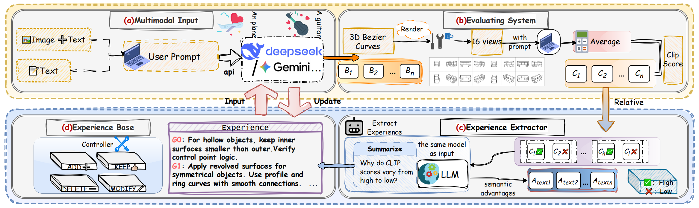

# 3DrawAgent

[](https://cvpr.thecvf.com/Conferences/2026)
[](#)
[](https://qi-cvlab.github.io/3DrawAgent/)
[](https://arxiv.org/abs/2604.08042)
[](https://github.com/Qi-CVLab/3DrawAgent)

Official implementation of **3DrawAgent: Teaching LLM to Draw in 3D with Early Contrastive Experience**.

> **⭐ CVPR 2026 Highlight Paper**

## Introduction

3DrawAgent is a training-free, language-driven framework for 3D sketch generation. Instead of updating model parameters, it uses large language models as 3D sketch planners and improves generation quality through contrastive experience learning. The framework represents sketches as 3D Bezier curves, scores them with CLIP-based rewards, and extracts reusable drawing experience for subsequent inference.

<p align="center">
  
</p>

## Installation

We recommend using **Python 3.10** with **conda**.

### 1. Create the environment

```bash
conda create -n 3drawagent python=3.10
conda activate 3drawagent
```

### 2. Install diffvg / pydiffvg

Please install `diffvg` / `pydiffvg` by following the official repository:

- Official repo: https://github.com/BachiLi/diffvg

### 3. Install the remaining dependencies

```bash
pip install -r requirements.txt
```

### 4. Configure API credentials

Create `.env` from the provided template:

```bash
cp .env.example .env
```

Then edit `.env`:

```env
OPENAI_API_KEY=your_api_key
OPENAI_MODEL=your_model_name
OPENAI_BASE_URL=
```

## Run

### Training-free experience learning

```bash
python train.py --prompts examples/prompts.json --output-dir outputs/train
```

### Inference with an experience library

```bash
python infer.py --prompt "A chair" --experiences outputs/train/experiences.json --output-dir outputs/chair
```

## Citation

If you find this work useful, please cite:

```bibtex
@inproceedings{xiao2026drawagent,
  title      = {3DrawAgent: Teaching LLM to Draw in 3D with Early Contrastive Experience},
  shorttitle = {3DrawAgent},
  author     = {Xiao, Hongcan and Xiao, Xinyue and Wang, Yilin and Zhang, Yue and Qi, Yonggang},
  booktitle  = {Proceedings of the {IEEE}/{CVF} Conference on Computer Vision and Pattern Recognition ({CVPR})},
  year       = {2026}
}
```
